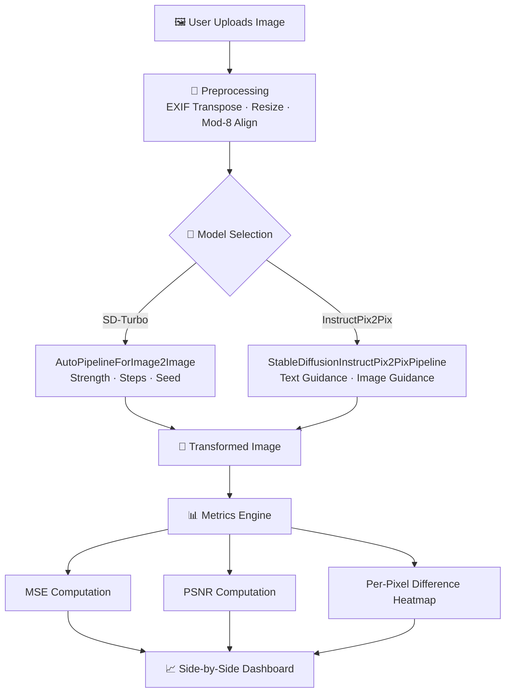

<p align="center">
  
</p>

<p align="center">
  
  
  
  
  
  
</p>

---

## 📋 Executive Summary

Traditional image editing tools require extensive manual effort and artistic skill to produce creative transformations. **AI Image Variation & Reconstruction Studio** bridges this gap by providing an intuitive, browser-based interface powered by state-of-the-art diffusion models.

Users upload any image and apply powerful AI-driven transformations using either **SD-Turbo** (fast image-to-image with strength control) or **InstructPix2Pix** (natural-language editing instructions). The application provides a **side-by-side comparison** between the original and transformed output, along with quantitative reconstruction metrics — **MSE** (Mean Squared Error) and **PSNR** (Peak Signal-to-Noise Ratio) — and a **per-pixel difference heatmap** for visual analysis.

---

## 📑 Table of Contents

- [Key Features & Capabilities](#-key-features--capabilities)
- [System Architecture](#-system-architecture)
- [Tech Stack Breakdown](#-tech-stack-breakdown)
- [Quickstart & Setup](#-quickstart--setup)
- [Project Directory Layout](#-project-directory-layout)
- [Author & Contributions](#-author--contributions)

---

## ✨ Key Features & Capabilities

- **Dual Model Support** — Choose between **SD-Turbo img2img** (fast, CPU-friendly, strength-based) and **InstructPix2Pix** (text-instruction-based editing with image/text guidance scales)
- **Interactive Streamlit UI** — Wide-layout, browser-based interface with a sidebar for all generation parameters
- **Smart Device Detection** — Automatically selects **CUDA**, **MPS** (Apple Silicon), or **CPU** for optimal performance
- **Adjustable Generation Parameters** — Fine-tune inference steps, seed, strength, image/text guidance scales, and max image size (256–640 px)
- **Side-by-Side Comparison** — Original and transformed images displayed in parallel columns
- **Quantitative Reconstruction Metrics** — Real-time **MSE** and **PSNR (dB)** computation between original and output
- **Per-Pixel Difference Heatmap** — Normalized visual map highlighting regions of maximum transformation
- **Cached Model Loading** — Uses `@st.cache_resource` to avoid redundant model downloads across reruns
- **EXIF-Aware Preprocessing** — Auto-rotates images based on EXIF data and normalizes dimensions to multiples of 8

---

## 🏗️ System Architecture



---

## 🛠️ Tech Stack Breakdown

| Category | Technology | Purpose |
|----------|-----------|---------|
| **Language** | Python 3.8+ | Core application language |
| **Web Framework** | Streamlit | Interactive browser-based UI |
| **Deep Learning** | PyTorch | Tensor operations & GPU acceleration |
| **Diffusion Models** | 🤗 Diffusers | SD-Turbo & InstructPix2Pix pipelines |
| **Transformers** | 🤗 Transformers | Model tokenizers & configs |
| **Acceleration** | Accelerate | Device placement & mixed precision |
| **Serialization** | Safetensors | Secure model weight loading |
| **Image Processing** | Pillow (PIL) | Image I/O, EXIF handling, resizing |
| **Numerical** | NumPy | MSE/PSNR calculations, array ops |

---

## 🚀 Quickstart & Setup

### Prerequisites

- Python 3.8 or higher
- (Recommended) NVIDIA GPU with CUDA for faster inference
- ~3 GB disk space for model weights (downloaded on first run)

### Installation

```bash
# Clone the repository
git clone https://github.com/Chaturyathukivakam/AI-Image-Variation-and-Reconstruction-Studio.git
cd AI-Image-Variation-and-Reconstruction-Studio

# Create and activate virtual environment
python -m venv venv
source venv/bin/activate        # macOS / Linux
# venv\Scripts\activate          # Windows

# Install dependencies
pip install -r requirements.txt
```

### Run the Application

```bash
streamlit run app.py
```

The app opens at `http://localhost:8501`. Upload an image, select a model, adjust parameters, and click **Transform**.

> 💡 **CPU Users:** Select **SD-Turbo** with image size 256–384 px for best performance.

---

## 📂 Project Directory Layout

```
AI-Image-Variation-and-Reconstruction-Studio/
├── app.py                # Main Streamlit application (model loading, UI, inference, metrics)
├── requirements.txt      # Python dependencies
└── README.md             # Project documentation
```

---

## 👤 Author & Contributions

**Chaturya Thukivakam**

[](https://github.com/Chaturyathukivakam)

Contributions, issues, and feature requests are welcome! Feel free to open a pull request.

---

<p align="center">
  
</p>
